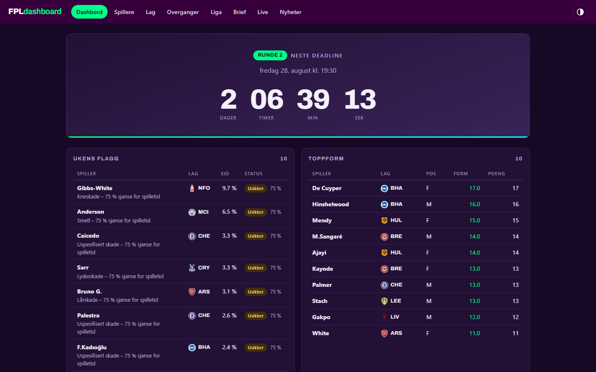
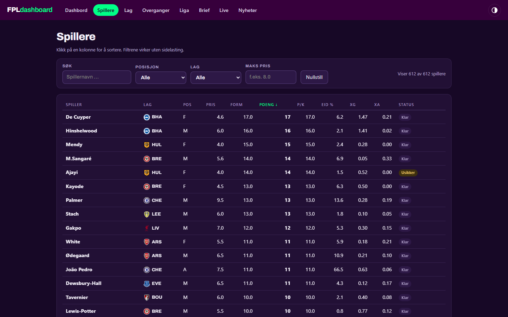
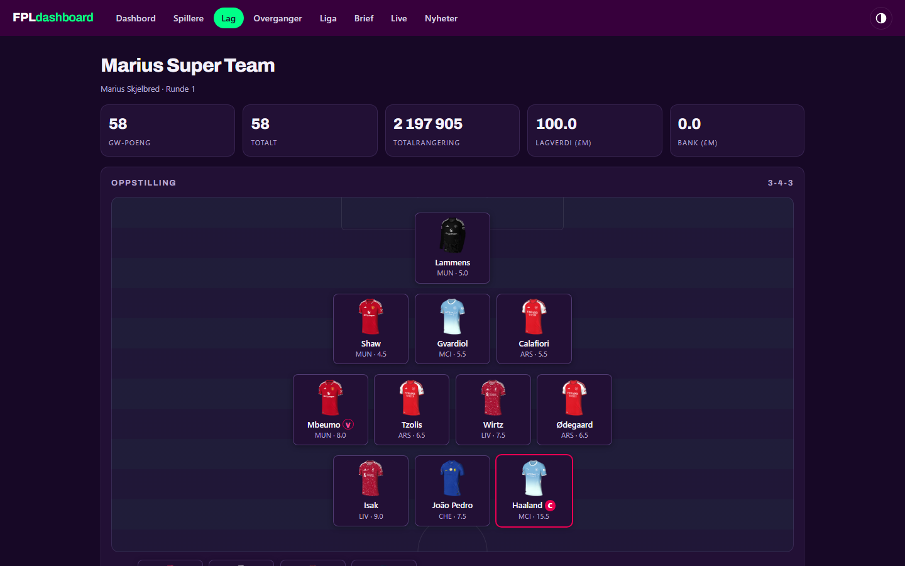

# FPL-dashboard

Selvhostet Fantasy Premier League-dashboard på norsk. Server-rendret
Express 5 + EJS, ingen database, ingen byggesteg. All data hentes fra det
åpne FPL-API-et — ingen innlogging eller API-nøkkel trengs for kjernen.

## Skjermbilder

Mørkt tema er standard; lyst tema og auto følger systemvalget.

| Dashbord | Spillere | Mitt lag |
| --- | --- | --- |
|  |  |  |

Mobil (390 px): [dashbord](docs/img/dashbord-mobil.png) ·
[spillere](docs/img/spillere-mobil.png) · [lag](docs/img/lag-mobil.png)

## Sider

| Side | Innhold | Status |
|---|---|---|
| `/` | Deadline-nedtelling, ukens flagg, toppform, mest kjøpt/solgt, FDR-matrise | ✅ |
| `/spillere` | Full spillertabell med sortering, filtrering og søk | ✅ |
| `/lag` | Mitt lag, kaptein- og transferanbefalinger | ✅ |
| `/liga` | Miniliga-tabeller og differensial-analyse | ✅ |
| `/live` | Live-poeng under pågående gameweek | ✅ |
| `/brief` | Gameweek-brief (data + valgfri AI) | ✅ |
| `/nyheter` | FPL-nyheter fra RSS + valgfri AI-oppsummering | ✅ |
| `/api/brief.json` | Briefen som JSON | ✅ |
| `/api/live.json` | Live-data som JSON (polles kun under kamper) | ✅ |
| `POST /api/ai-rad` | AI-råd for laget ditt (krever `ANTHROPIC_API_KEY`) | ✅ |
| `/health` | `{"status":"ok"}` for helsesjekk | ✅ |

Se `ROADMAP.md` for full plan og fremdrift.

## Lokal kjøring

Krever Node 22+.

```bash
npm install
cp .env.example .env   # fyll inn FPL_TEAM_ID m.m. (valgfritt for / og /spillere)
npm run dev            # utvikling med auto-restart
npm start              # produksjon
npm test               # tester (node:test)
npm run lint           # ESLint
```

## Miljøvariabler

| Variabel | Påkrevd | Beskrivelse |
|---|---|---|
| `PORT` | nei (3000) | Port serveren lytter på |
| `FPL_TEAM_ID` | for /lag, /liga, /live | Din team-ID — tallet i URL-en på «Points»-siden: `/entry/DIN_ID/event/1` |
| `LEAGUE_IDS` | nei | Kommaseparerte miniliga-ID-er. Tomt = hentes fra laget ditt |
| `NEWS_FEEDS` | nei | Kommaseparerte RSS-URL-er. Tomt = BBC/Sky-defaults |
| `ANTHROPIC_API_KEY` | nei | Aktiverer AI-funksjoner (nyheter, brief, rådgiver) |
| `AI_MODEL` | nei (`claude-sonnet-5`) | Claude-modell. Billig-alternativ: `claude-haiku-4-5` |
| `DISCORD_WEBHOOK_URL` | nei | Aktiverer auto-brief før deadline |
| `BRIEF_HOURS_BEFORE_DEADLINE` | nei (24) | Timer før deadline auto-briefen sendes |
| `TZ` | nei (`Europe/Oslo`) | Tidssone for visning |

Appen starter og viser `/` uten noen av disse satt.

## Deploy på Coolify

1. **Ny ressurs** → koble Git-repoet, velg **Dockerfile** som build pack
2. **Port**: 3000
3. **Health check**: path `/health` (Dockerfilen har også innebygd `HEALTHCHECK`)
4. **Env-variabler**: sett minst `FPL_TEAM_ID` (og `ANTHROPIC_API_KEY` for AI) i
   Coolify — aldri i repoet
5. Aktiver **auto-deploy** (webhook) — hver push til `main` går rett i prod

## Arkitektur

```
src/server.js      oppstart, middleware, feilhåndtering
src/config.js      env-variabler med validering og defaults
src/routes/        tynne ruter, én per side
src/services/      fplClient (eneste FPL-nettverkskall), cache (TTL+SWR),
                   analysis (ren logikk), format
views/             EJS-views med felles layout
public/            style.css, app.js (vanilla)
test/              node:test — ren logikk, ingen nettverkskall
```

FPL-API-et caches server-side (bootstrap 15 min, live 1 min osv.), med
stale-while-revalidate og deduplisering — mange besøkende gir få API-kall.
Ved 503 fra FPL («game is being updated») serveres sist kjente data med et
banner i stedet for feil.
